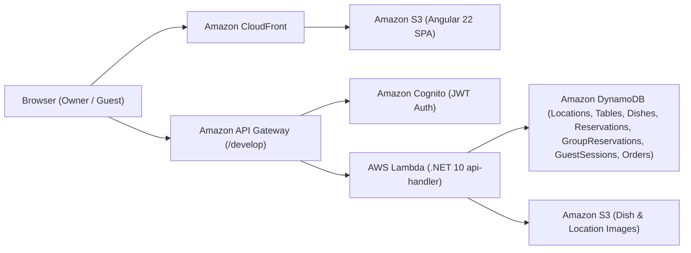

# Green & Tasty — Restaurant Management & Group Pre-Order Platform

Full-stack cloud-native web application developed for **EPAM IT Marathon 2026** (DevOps / Cloud Architecture, Backend .NET, and Frontend Angular tracks).

---

## 🌐 Live Deployment (AWS)

| Environment / Service | URL |
| :--- | :--- |
| **Frontend Web App (CloudFront + S3)** | **[https://d3bnmono898o6h.cloudfront.net](https://d3bnmono898o6h.cloudfront.net)** |
| **Backend REST API (API Gateway `develop`)** | `https://fiw10fpnv9.execute-api.eu-north-1.amazonaws.com/develop` |
| **AWS Region** | `eu-north-1` (Europe — Stockholm) |

---

## 🏗️ Architecture & Tech Stack



- **Frontend:** Angular 22 (Standalone Components, Signals, `@if` / `@for` control flow, RxJS, SCSS), Jasmine & Karma
- **Backend:** .NET 10 (`dotnet10` AWS Lambda runtime), AWS SDK for .NET (DynamoDBv2, CognitoIdentityProvider, S3, SQS), xUnit, Moq, FluentAssertions
- **Infrastructure & Deployment:** Terraform (`infra/terraform`), AWS Syndicate (`backend/restaurant-backend-app`), Amazon S3 + CloudFront

---

## 📁 Repository Structure

```text
.
├── backend/
│   └── restaurant-backend-app/          # .NET 10 Serverless Backend (AWS Lambda + Syndicate)
│       ├── dnapp/lambdas/api-handler/   # REST API handlers, services, repositories, models
│       ├── Tests/                       # xUnit unit tests (153 passing tests)
│       └── deployment_resources.json    # API Gateway & DynamoDB declarative configuration
├── frontend/
│   └── restaurant-frontend-app/         # Angular 22 Single-Page Application
│       ├── src/app/
│       │   ├── components/group-orders/participant-card/  # ParticipantCardComponent (Practice + Bonus)
│       │   ├── pages/group-order-page/                    # GroupOrderPageComponent (Levels 1–3 + Bonus)
│       │   ├── services/group-orders/                     # GroupOrdersService
│       │   └── shared/helpers/consolidate-pre-order.ts    # Pure pre-order aggregation helper
│       └── homework-tests/              # Reference test suites for Practice & Levels 1–3 + Bonus
├── infra/
│   └── terraform/                       # Terraform IaC (S3, CloudFront, Cognito, SQS, EventBridge, IAM)
├── homework-design/                     # Exported Figma mockups & design notes for Owner Flow
├── homework-backend.md                  # Backend homework specification (.NET)
├── homework-frontend.md                 # Frontend homework specification (Angular)
└── practice-frontend.md                 # Frontend practical task specification
```

---

## ✅ Implemented Homework Scope

### 1. Backend (.NET 10) — All 3 Levels Completed
Implemented in `backend/restaurant-backend-app/dnapp/lambdas/api-handler`:

- **Level 1 — `GET /guest/groups/{groupReservationId}/sessions`** (`GetAllGuestSessionsHandler`, `GuestSessionService.GetAllSessionsAsync`):
  - Loads all `GuestSession` records for the group reservation, batch-loads unique dishes via `IDishService.GetDishesByIdsAsync`, maps `Participant` (`Owner` / `Guest`) items and subtotals, and computes the group `Total` from submitted sessions.
- **Level 2 (Task 2.1) — `GET /reservations/{reservationId}/guest-session-id`** (`GetOwnerSessionIdHandler`, `GuestSessionService.GetOwnerSessionIdAsync`):
  - Verifies reservation existence (`404` if missing), checks reservation ownership (`403` if caller is not the owner), and returns the owner's `GuestSessionId`.
- **Level 2 (Task 2.2) — `POST /group-reservations/{groupReservationId}/submit`** (`SubmitGroupPreOrderHandler`, `GuestSessionService.SubmitGroupPreOrderAsync`):
  - Validates that the `GroupReservation` exists and is `Open`, verifies owner authorization, aggregates dish quantities across all submitted participant sessions, updates the reservation's `Order` and sets `GroupReservation.Status = Submitted`.
- **Level 3 — `DELETE /guest/groups/{groupReservationId}/sessions/{guestSessionId}`** (`DeleteGuestSessionHandler`, `GuestSessionService.DeleteGuestSessionAsync`):
  - Supports both Guest self-removal (`X-Guest-Token`) and Owner guest removal (Cognito JWT `sub`).
  - Prevents deleting the owner's own session (`400 Bad Request`) or modifying a group reservation that is no longer `Open`, and returns the updated `GetAllSessionsResponse` snapshot (`200 OK`).

### 2. Frontend (Angular 22) — Practice + All 3 Levels + Bonus Completed
Implemented in `frontend/restaurant-frontend-app`:

- **Practice — `ParticipantCardComponent`:**
  - Signal-based inputs (`participant`, `isMe`, `canRemove`) and `removeClick` output.
  - Computed title (`My Pre-Order` for the owner's card, `Owner: <Name>` / `Guest: <Name>` otherwise), status chips (`Submitted` / `Still choosing`), dish list with lazy-loaded avatars or initial fallback, `Subtotal`, and accessible `Remove Guest` button (`aria-label="Remove <Name>"`).
- **Level 1 — Owner Review Screen (`/reservations/:reservationId/group-order`):**
  - Extended `GroupOrdersService` (`getSessions$`, `getOwnerSessionId$`, `getStatus$`, `submit$`, `removeSession$`).
  - Added `AuthGuard`-protected route and **Group Pre-Order** button on `CardReservationComponent` for upcoming customer reservations with `guestCount >= 2`.
  - Built `GroupOrderPageComponent` with parallel initial data loading (`forkJoin`), owner-first sorting, unsubmitted-participants warning banner, `consolidatePreOrder` summary section, and `Grand Total`.
- **Level 2 — Submit Pre-Order & 15s Live Synchronization:**
  - Confirmation modal (`<app-modal>`) before submitting the consolidated pre-order, status transition to `Sent to restaurant`, and toast feedback.
  - Background polling every 15 seconds (`interval(15_000)` + `exhaustMap` + `takeUntilDestroyed`) using `{ silent: true }` (`SKIP_ERROR_TOAST`), with `Updated at HH:mm:ss` indicator, manual **Refresh** button, and non-intrusive inline error message on refresh failure.
- **Level 3 + Bonus — Live AWS Integration & Remove Guest:**
  - Connected to the deployed AWS API Gateway (`https://fiw10fpnv9.execute-api.eu-north-1.amazonaws.com/develop`).
  - Implemented **Remove Guest** confirmation modal and instant participant list / consolidated total update from the `DELETE` response snapshot.

---

## 🧪 Running & Testing Locally

### Backend Unit Tests (.NET 10)
```bash
cd backend/restaurant-backend-app
dotnet test Tests/APIHandler.Tests.csproj
```
*(Result: **153 passed, 0 failed**)*

### Frontend Unit Tests (Angular 22)
```bash
cd frontend/restaurant-frontend-app
npm ci
npm run test:hw -- --browsers=ChromeHeadless
```
*(Result: **67 SUCCESS, 0 FAILED** across Practice, Level 1, Level 2, Level 3, and Level 3 Bonus)*

### Local Development Server & Demo Mode
```bash
cd frontend/restaurant-frontend-app
npm start
```
- **Interactive Demo Mode (in-memory mock store):**
  Open `http://localhost:4200/reservations/demo-reservation/group-order?demo`
- **Live AWS Backend Mode:**
  Open `http://localhost:4200` (configured in `src/environments/environment.development.ts` to talk to `https://fiw10fpnv9.execute-api.eu-north-1.amazonaws.com/develop`).

---

## 🚀 AWS Deployment Guide

### 1. Infrastructure (Terraform)
```bash
cd infra/terraform
terraform init
terraform apply -auto-approve
```

### 2. Backend (AWS Syndicate)
```bash
cd backend/restaurant-backend-app
source syndicate_venv/bin/activate
export SDCT_CONF="$(pwd)/.syndicate-config-restaurant-backend-app"
syndicate build
syndicate update
```

### 3. Frontend (Angular Production Build -> S3 + CloudFront)
```bash
cd frontend/restaurant-frontend-app
BACKEND_URL=https://fiw10fpnv9.execute-api.eu-north-1.amazonaws.com/develop npm run build
aws s3 sync dist/restaurant-frontend-app/browser s3://restaurant-frontend-591015654179/ --delete --region eu-north-1
aws cloudfront create-invalidation --distribution-id E2FMA27XYYCOAA --paths "/*"
```
